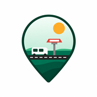

  

<h1 align="center">WayPoint</h1>

<strong>A travel alarm that follows your destination.</strong>

Location-based reminders for passengers who want to spend less time watching the map.

  
  
  
  
  

## The problem

A passenger can miss a stop while sleeping, listening to music, or travelling through an unfamiliar area. A clock alarm is only an estimate: traffic and unexpected delays change when the destination will actually be near. Checking a map throughout the journey takes attention and makes it harder to rest.

## The solution

WayPoint connects the alarm to a chosen location. It monitors proximity during a trip and increases the urgency of its reminders as the passenger gets closer. A gentle heads-up gives time to prepare; voice guidance and a stronger wake-up alarm draw attention near the destination.

The app brings destination selection, saved places, background tracking, and multilingual reminders into one Android experience. Its goal is to help passengers notice their stop without continuously checking their phones.

## Progressive alerts

The default Bus / Car experience uses four distance-based stages:

| Distance to destination | Stage | What the passenger receives |
| --- | --- | --- |
| 5 km | Heads-up | A gentle chime and vibration |
| 2 km | Proximity | Stronger vibration and attention pings |
| 1 km | Voice guidance | A spoken destination reminder |
| 0.5 km | Wake-up | A continuous alarm and vibration until dismissed |

Stages can be skipped when a trip starts close to the destination. Distances are straight-line estimates from location updates, not remaining road distance. A wake-up alert means the destination is nearby; it does not confirm that the vehicle has reached the stop.

## Made for everyday journeys

- **Flexible destination selection:** Search for a place, position a map pin, or import a shared map link.
- **Saved places:** Keep frequently used destinations on the device for repeat trips.
- **Background trip status:** Follow distance and estimated arrival through the app and a foreground notification.
- **Voice reminders:** English, Tamil, and Hindi announcements, with English fallback when the selected voice is unavailable.
- **Direction awareness:** Use recent movement to distinguish approaching, moving away, and detours.
- **Clear trip controls:** Review the selected destination, return from the map picker, and stop tracking or dismiss an alarm.
- **In-app Help:** Find destination setup guidance and an explanation of progressive alerts from the main screen.

## Technology

| Technology | Role |
| --- | --- |
| Kotlin & coroutines | Application logic and asynchronous work |
| Android SDK & AndroidX | Native Android lifecycle, activities, and background services |
| Material Components & XML layouts | Interface controls and screens |
| Google Play services Location | Device location updates |
| OpenStreetMap & osmdroid | Interactive destination map |
| Android Geocoder & Photon | Place search and address lookup |
| Room & SQLite | On-device saved destinations |
| Android Text-to-Speech & audio APIs | Spoken reminders, alarm sounds, and vibration |
| Gradle & KSP | Build tooling and Room code generation |
| JUnit & Robolectric | Automated workflow regression checks |

Supports Android 7.0 and later; targets Android 15.

## Launch preparation

The supplied [original logo](branding/WAYPOINT.png) and [512×512 store icon](branding/play-store-icon.png) are included in the repository. Production signing, device testing, legal pages, and deployment remain pending.

## Data and device behaviour

Saved destinations are stored on the device, and trip distance and alert decisions are calculated locally. Map tiles, place search, address lookup, and shared-link resolution can contact external providers. These requests may include search text, coordinates, or the selected map area.

Tracking uses device location after a destination is selected. Fresh map data and online search need an internet connection. Voice availability depends on installed speech services; alert delivery also depends on location access, notification permissions, device settings, and Android background restrictions.

---

Developed by **[Shadow-Protectors](https://github.com/Shadow-Protectors)**.
